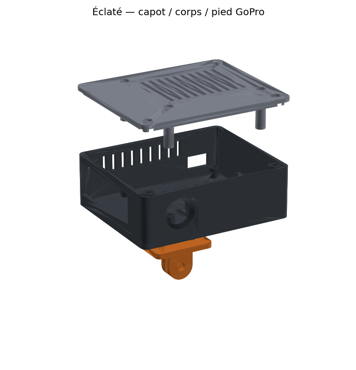

# Box V1 — printable enclosure

Enclosure for a Raspberry Pi 5 + official Active Cooler + Camera Module 3 Wide.
Outer size 92 × 77 × 32 mm. Designed to print without supports.



## Files (`out/`)

| File | Part |
|---|---|
| `boring_box_body.stl` | Body: Pi standoffs, camera ribs, openings |
| `boring_box_lid.stl` | Lid, already flipped for printing |
| `boring_box_gopro_foot.stl` | GoPro-compatible two-prong foot |
| `boring_box_fit_coupon.stl` | Thin test plate for the Pi and camera hole patterns |
| `boring_box_v1.step` | Full assembly, editable |

## Print

PETG, 0.4 mm nozzle, 0.2 mm layers, 4 walls, 20 % gyroid, no supports.
PLA softens in a parked car and is not suitable. Print the fit coupon first.

## Hardware

- 4 × M2.5 × 30 pan head: lid → clamp tube → Pi → standoff
- 2 × M2.5 × 10: lid → front posts
- 4 × M2 × 6: camera
- 2 × M3 × 8 + 2 M3 nuts: foot (nuts are captive under the Pi)
- 5 mm LED + 330 Ω resistor: GPIO17 (pin 11) to GND (pin 9)

The camera is mounted connector-up, so the image is rotated 180°:
set `CAMERA_ROTATION=180` (see `docs/BOX.md`).

## Rebuild and check

```bash
uv run --no-project --python 3.12 --with build123d python boring_box.py
uv run --no-project --python 3.12 --with build123d python boring_box.py --check
```

`--check PI5.step CAMERA3_WIDE.stp` runs the interference check against the
official Raspberry Pi STEP models (datasheets.raspberrypi.com) instead of
simplified volumes. Dimensions were taken from the official mechanical
drawings; the enclosure has not been printed or assembled yet.
